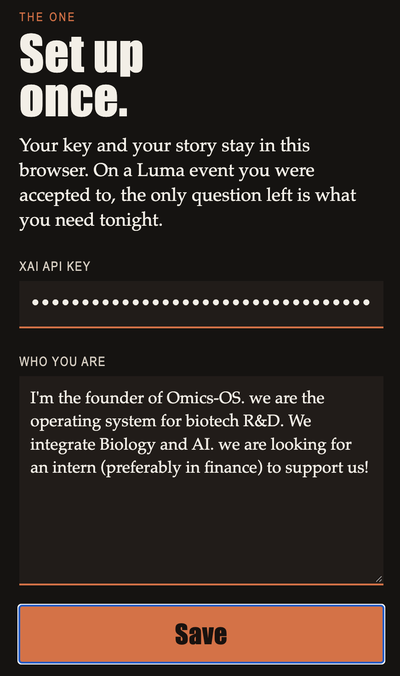
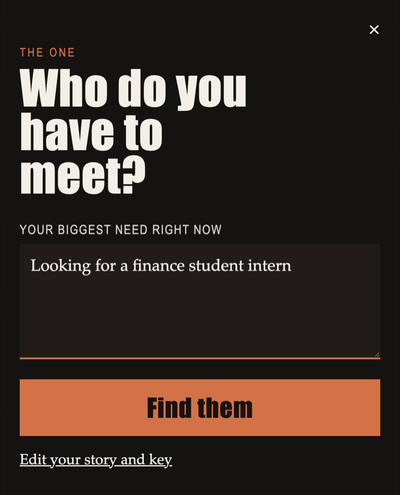
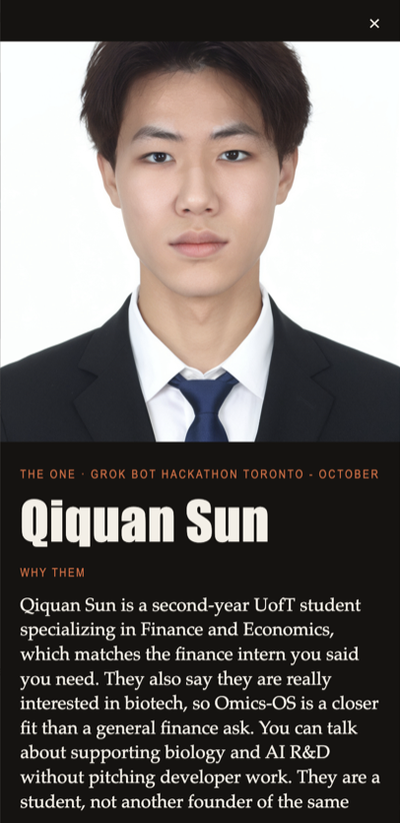
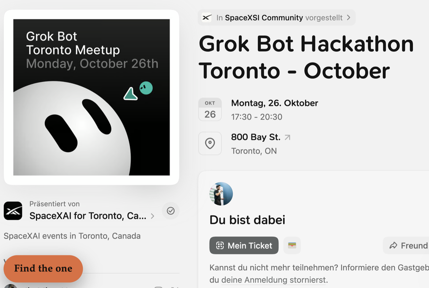

# The One

You are in a room full of people. One of them is the person you should actually talk to.

The One is a Chrome extension for that moment. You say who you are, once. On a Luma event you were accepted to, you type the one thing you need tonight. It reads the guest list you can already see, asks Grok to choose a single person, and gives you their face so you can walk over.

## A night with it

Three beats. Then you walk over.

<table>
  <tr>
    <td align="center" width="33%"></td>
    <td align="center" width="33%"></td>
    <td align="center" width="33%"></td>
  </tr>
  <tr>
    <td align="center"><b>Once</b> Key and story. They stay in this browser.</td>
    <td align="center"><b>Tonight</b> The one thing you need right now.</td>
    <td align="center"><b>The person</b> Their face, the reason, how to find them.</td>
  </tr>
</table>

On the event, **Find the one** waits at the bottom left.

  

While it looks, two lines tell you where it is. The guest list counts people as they come in. Grok waits until that count is finished, then chooses one person.

If the host hid the list, or Luma has not marked you as going, it stops and says so. No stand-in room. No second-place list.

## Install

1. Download [the-one.zip](https://github.com/cewinharhar/the-one/releases/download/v0.1.0/the-one.zip).
2. Unzip it. Inside is a folder named `the-one`, with `manifest.json` in it.
3. Open Chrome and go to `chrome://extensions`.
4. Turn on **Developer mode**.
5. Click **Load unpacked** and choose that folder.
6. Pin **The One**, click the icon, paste your [xAI key](https://console.x.ai/team/default/api-keys) and who you are, then save.

Use a normal Chrome window on a computer. Incognito, Guest mode, and iPhone Chrome cannot load it.

## What it sends

Grok receives names, short bios, and the public links already on those profiles, plus what you wrote about yourself and what you need tonight. One call. The photo on the card comes from Luma, not from the model.

Emails and phone numbers are not read. Your key stays in the browser and is only sent to xAI, as the header on that call. It is not in this repository.
